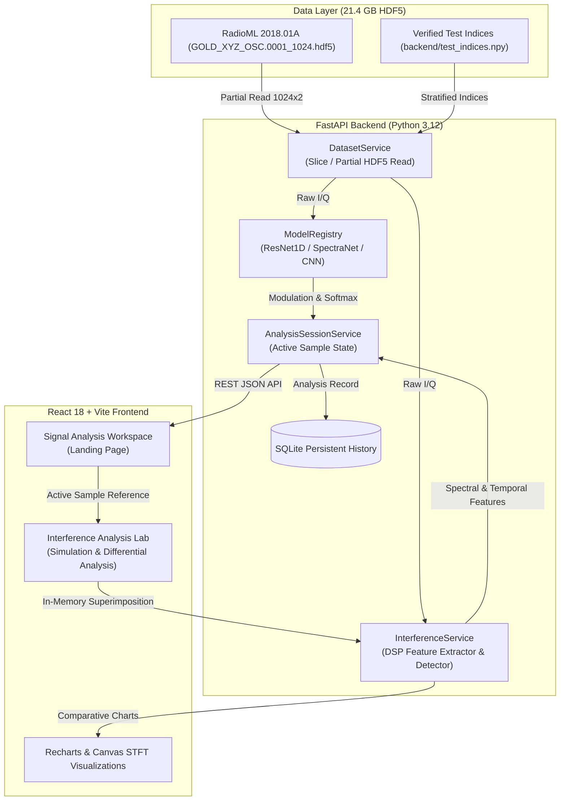

# SpectraGuard: AI-Assisted Passive RF Spectrum Intelligence Platform

[](https://python.org)
[](https://fastapi.tiangolo.com)
[](https://pytorch.org)
[](https://react.dev)
[](https://vitejs.dev)
[](LICENSE)

SpectraGuard is a passive, defense-oriented RF spectrum analysis and electronic-warfare awareness platform. It connects directly to raw in-phase/quadrature (I/Q) radio frequency signal data, performs automated modulation classification via deep neural networks, calculates deterministic digital signal processing (DSP) features, and provides explainable, rule-based interference analysis for human-in-the-loop technical evaluation.

> [!IMPORTANT]
> **Defensive Passive Spectrum Awareness Only**: This platform is designed solely for passive RF signal monitoring, modulation recognition, and analytical decision support. The system does not implement RF jamming, active signal disruption, automated counter-attacks, or offensive electronic warfare operations.

---

## 1. Problem Statement & Objectives

Modern radio frequency (RF) operating environments are congested, contested, and dynamic. Human operators face significant cognitive overload when attempting to manually identify modulation schemes and detect intermittent or intentional interference in high-throughput spectrum streams.

**SpectraGuard Addresses These Challenges By:**
1. **Automating Modulation Recognition**: Classifying 24 distinct analog and digital modulation schemes directly from raw complex time-domain I/Q data using trained deep neural network architectures (`ResNet1D`, `SpectraNet`, and `CNN`).
2. **Deterministic DSP Feature Extraction**: Measuring power statistics, spectral flatness, occupancy, peak prominence, and time-frequency dynamics without relying on black-box heuristics.
3. **Transparent Interference Assessment**: Providing explainable, evidence-backed indicators (`No strong evidence`, `Possible interference`, `Inconclusive`) to help operators investigate potential interference without falsely asserting operational jamming or hostile intent.
4. **Controlled Simulation Laboratory**: Superimposing synthetic interference patterns in memory against identical baseline records to evaluate classifier robustness and signal degradation without altering source datasets.

---

## 2. Architecture & Data Flow



### Complete End-to-End Processing Workflow
1. **Sample Selection**: Operator selects a sample index manually (0 to 2,555,903) or chooses the alternating random sequence from the verified test set.
2. **Partial HDF5 Read**: `DatasetService` reads exact slice offsets `X[index]`, `Y[index]`, and `Z[index]` (21.4 GB file is never loaded into RAM).
3. **Model Inference**: The active deep neural network evaluates the transposed tensor `(1, 2, 1024)` in `torch.inference_mode()`, generating class probabilities and top-5 rankings across 24 modulation schemes.
4. **DSP Feature Extraction**: `InterferenceService` computes time-domain power, peak-to-average power ratio (PAPR), Hann-windowed FFT spectrum, spectral flatness, occupancy, and 16-window STFT variance.
5. **Session Synchronization**: The analyzed sample is registered in `AnalysisSessionService`, linking the active record across both Signal Analysis and Interference views.
6. **Interference Simulation**: If investigated in the Interference Lab, an in-memory synthetic waveform (tone, sweep, pulsed, or broadband noise) is generated, analyzed independently, and compared side-by-side with the unmodified baseline.

---

## 3. Technology Stack

- **Backend**: Python 3.12, FastAPI 0.115, Uvicorn, Pydantic v2
- **Deep Learning / ML**: PyTorch 2.2+, NumPy, SciPy Signal, h5py
- **Database**: SQLite3 with dedicated indexing on dataset indices and timestamps
- **Frontend**: React 18, Vite 8.3, Tailwind CSS, Lucide React, Recharts, Axios
- **Testing & QA**: Pytest, FastAPI TestClient, Vitest/Vite production build pipeline
- **Containerization**: Multi-stage Docker, Docker Compose

---

## 4. Model Architectures & Measured Evaluation Results

Three distinct neural architectures were trained on the RadioML 2018.01A dataset using realistic reception conditions ($\text{SNR} \ge 5\text{ dB}$, spanning 6 to 30 dB). All checkpoints are preserved and available for evaluation:

| Model Architecture | Parameter Count | Test Accuracy | Precision (Macro) | Recall (Macro) | F1-Score (Macro) | Checkpoint File |
| :--- | :---: | :---: | :---: | :---: | :---: | :--- |
| **ResNet1D** *(Winner)* | **7,356,184** | **89.99%** | **90.88%** | **89.99%** | **89.82%** | `outputs/models/best_resnet_model.pth` |
| **SpectraNet** *(Hybrid)* | **579,288** | **88.90%** | **89.67%** | **88.90%** | **88.43%** | `outputs/models/best_spectranet_model.pth` |
| **CNN** *(Baseline)* | **419,992** | **66.47%** | **69.16%** | **66.47%** | **64.31%** | `outputs/models/best_cnn_model.pth` |

*Results verified against `outputs/results/model_comparison_detailed.csv` and `notebooks/SpectraGuard_RF_Models.ipynb`.*

### Supported Modulation Classes (24 Schemes)
```
OOK, 4ASK, 8ASK, BPSK, QPSK, 8PSK, 16PSK, 32PSK,
16APSK, 32APSK, 64APSK, 128APSK, 16QAM, 32QAM, 64QAM, 128QAM, 256QAM,
AM-SSB-WC, AM-SSB-SC, AM-DSB-WC, AM-DSB-SC, FM, GMSK, OQPSK
```

---

## 5. DSP Feature Extraction & Interference Analysis

Modulation recognition is kept strictly separated from interference assessment. The DSP engine evaluates physical signal properties rather than treating classification shifts as interference proof:

### Extracted Features & Numerical Standards
- **Signal Power ($P_{\text{sig}}$)**: Logarithmic mean instantaneous power: $10 \log_{10}(\frac{1}{N} \sum |x[n]|^2 + 10^{-12})\text{ dB}$.
- **PAPR**: Peak-to-Average Power Ratio: $10 \log_{10}(\frac{\max |x[n]|^2}{P_{\text{sig}}})$. Handled with zero-power safeguards.
- **Spectral Flatness (SFM)**: Ratio of geometric mean to arithmetic mean of Hann-windowed FFT power bins: $\frac{\exp(\frac{1}{N}\sum \ln S[k])}{\frac{1}{N}\sum S[k]}$.
- **Spectral Occupancy**: Fraction of frequency bins exceeding the estimated noise floor by more than $10\text{ dB}$.
- **STFT Temporal Dynamics**: 16 non-overlapping temporal windows measuring energy variance and peak frequency migration.

### Explainable Detection Categories
- `Possible interference`: Strong narrowband peak stability (Tone-like), migrating spectral peaks (Sweep-like), high temporal energy bursts (Pulsed), or wideband elevation (Broadband noise).
- `No strong evidence`: Features match expected modulation in Gaussian noise.
- `Inconclusive`: Marginal power or occupancy shifts that cannot be conclusively separated from channel noise.

---

## 6. API Reference

All endpoints accept and return JSON. OpenAPI interactive documentation is accessible at `http://localhost:8000/docs`.

### Core Endpoints

#### 1. System Health & Catalog
- `GET /api/health`: Service status, active models, device (CPU/CUDA).
- `GET /api/models`: Catalog of available models with parameter counts and test scores.
- `GET /api/dataset/info`: RadioML 2018.01A dataset metadata and sample counts.

#### 2. Signal Analysis
- `POST /api/signals/analyze`: Analyze specific HDF5 index.
  ```json
  {
    "dataset_index": 14520,
    "model_name": "ResNet1D"
  }
  ```
- `GET /api/sample/random?model_name=ResNet1D`: Returns verified test sample, alternating between correct and incorrect predictions.
- `GET /api/sample/active`: Retrieves current active sample reference across views.

#### 3. Interference Simulation
- `POST /api/interference/simulate`: Executes in-memory simulation against active sample.
  ```json
  {
    "dataset_index": 14520,
    "model_name": "ResNet1D",
    "seed": 42
  }
  ```
- `GET /api/interference/history`: Retrieves recent simulation records.

---

## 7. Installation & Local Setup

### Prerequisites
- Python 3.12+
- Node.js 20+ and npm
- RadioML 2018.01A HDF5 dataset placed in `data/raw/RadioML2018/` (or configured via `.env`)

### Step 1: Clone & Configure Environment
```bash
git clone https://github.com/your-org/SpectraGuard.git
cd SpectraGuard

# Copy environment configuration
cp .env.example .env
```

### Step 2: Backend Setup
```bash
# Create and activate virtual environment
python -m venv venv
.\venv\Scripts\Activate.ps1    # On Windows
# source venv/bin/activate      # On Linux/macOS

# Install backend dependencies
pip install -r requirements.txt

# Run test suite to verify installation
pytest -v
```

### Step 3: Frontend Setup
```bash
cd frontend
npm install
npm run build     # Verify clean production build
npm run dev       # Start local development server
```

### Step 4: Run Application
- **Backend API**: `python -m uvicorn backend.main:app --host 127.0.0.1 --port 8000 --reload`
- **Frontend UI**: `http://localhost:5173/`

---

## 8. Containerized Deployment (Docker Compose)

SpectraGuard includes multi-stage Dockerfiles that run services as unprivileged non-root users. Datasets and model checkpoints are mounted via read-only volumes so large binaries are never baked into image layers.

```bash
# Build and launch services in background
docker compose up --build -d

# Check container health and status
docker compose ps
docker compose logs -f backend
```

- Web Application: `http://localhost:5173`
- Backend API Docs: `http://localhost:8000/docs`

---

## 9. Automated Testing & Verification

The test suite covers dataset integrity, neural network loading, DSP math, and API routes:

```bash
# Run complete test suite
pytest -v

# Run specific domain test
pytest tests/test_dsp.py -v
pytest tests/test_models.py -v
```

**Test Coverage Summary:**
- `tests/test_dataset.py`: Slice reads, index validation, test-set split integrity.
- `tests/test_models.py`: Architecture loading, parameter verification, forward inference, probability validity.
- `tests/test_dsp.py`: Zero-signal numerical stability, pure tone detection, pulse detection, feature completeness.
- `tests/test_interference.py`: Dataset immutability, seed reproducibility, cross-view assessment consistency.
- `tests/test_api.py`: FastAPI endpoints, Pydantic validation, alternating sequence, simulation lifecycle.

---

## 10. Security & Safety Assumptions

1. **Input Validation**: All dataset indices are constrained within $[0, 2555903]$. Out-of-bounds requests return HTTP 422 before reaching file handles.
2. **Read-Only Data Layer**: HDF5 dataset handles are opened in read-only mode (`mode="r"`). In-memory signal derivations never write back to disk.
3. **CORS Governance**: Configured strictly via `CORS_ORIGINS` environment variable, avoiding wildcard cross-origin access in production.
4. **Information Leakage Prevention**: Database errors and model runtime exceptions are logged internally; client responses receive structured, sanitized error descriptions.
5. **Defense-Oriented Analysis**: No transmission or jamming APIs exist in the codebase. All processing is strictly passive analysis.

---

## 11. Implemented Features vs. Future Scope

| Feature Component | Status | Description |
| :--- | :---: | :--- |
| **RadioML 2018.01A Partial HDF5 Integration** | **Implemented** | Direct slice reading with zero full-dataset memory loading. |
| **Multi-Model Registry (ResNet1D, SpectraNet, CNN)** | **Implemented** | Interactive model selection, parameter verification, top-5 confidence. |
| **DSP Feature Extraction Engine** | **Implemented** | Power, PAPR, noise floor, spectral occupancy, spectral flatness, STFT variance. |
| **Explainable Rule-Based Anomaly Detector** | **Implemented** | Independent detection without reading simulation variables; cross-view consistency. |
| **Controlled Interference Simulation Lab** | **Implemented** | In-memory superposition of tone, sweep, pulse, and noise waveforms with seeds. |
| **Persistent SQLite History & Session Sync** | **Implemented** | Indexed historical analysis logs and active sample state persistence. |
| **Live SDR Streaming Integration (e.g., RTL-SDR, HackRF)** | *Future Scope* | Planned hardware abstraction layer for physical antenna feeds. |
| **Open-Set Unknown Signal Clustering** | *Future Scope* | Unsupervised feature clustering for uncataloged modulation schemes. |
```
